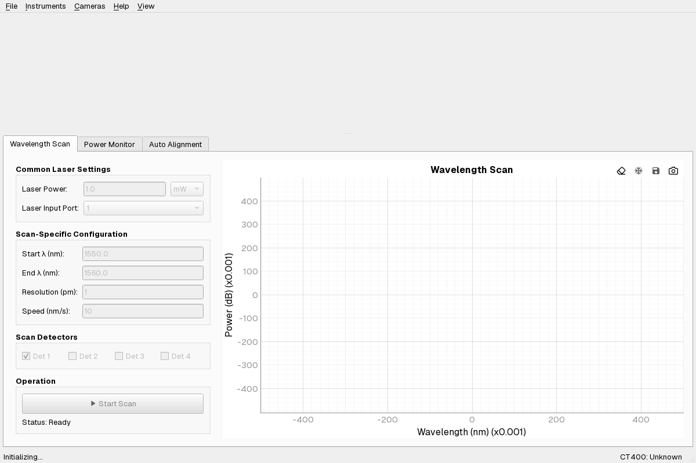
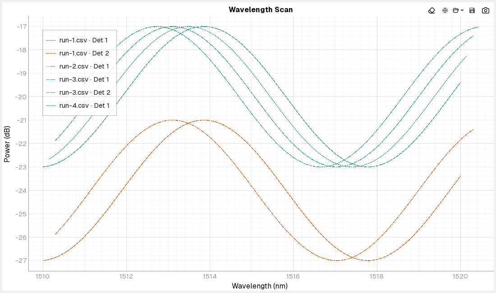
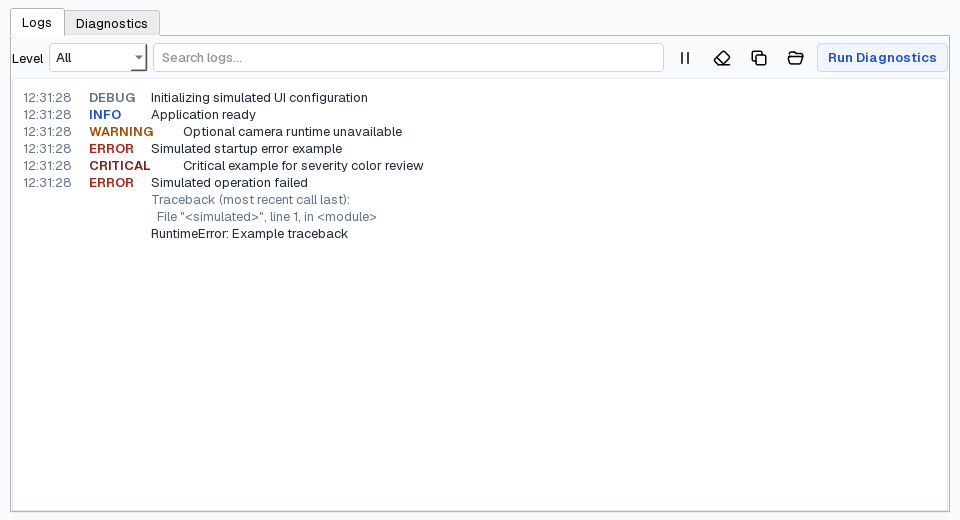

# IOPanel

**Laboratory control and data visualization for photonics research.**

A Python and PySide6 desktop application for instrument control, automated
optical measurements, and sample alignment.

[Features](#key-features) ·
[Installation](#installation) ·
[Documentation](#documentation) ·
[Development](#development) ·
[Contributing](CONTRIBUTING.md)

IOPanel desktop interface. Screenshots document application features; instrument availability depends on the configured backend and laboratory hardware.

---

## Key Features

- **Automated wavelength scans.** Configure and visualize tunable-laser sweeps using
  the Yenista CT400, with detector measurements and acquisition metadata.
- **Live optical-power monitoring.** Monitor detector channels during alignment;
  the Thorlabs PM5020 panel supports simulation and a separately configured
  physical backend.
- **Multi-camera alignment.** View multiple Allied Vision Vimba X camera streams,
  with independent exposure and gain controls and asynchronous initialization.
- **Measurement comparison and export.** Export scan data to CSV and MATLAB
  `.mat`, reopen supported schema-v2 measurements, and compare saved traces with
  overlays. Native MATLAB `.fig` export additionally requires MATLAB Engine.
- **Laboratory-oriented reliability.** Validated configuration, background
  operations, diagnostics, logging, and simulated backends for development
  without connected instruments.

### More of the interface

| Saved wavelength scans | Log console and diagnostics |
| :---: | :---: |
|  |  |

## Installation

IOPanel targets **Windows x64 and Python 3.12** for its validated laboratory
profile. It uses [uv](https://docs.astral.sh/uv/) to manage dependencies.
Cloning the source does **not** install proprietary SDKs, device drivers, or
MATLAB itself.

### Driver-free development and simulation

After installing Git and uv:

~~~powershell
git clone https://github.com/simoneferraresi/IOPanel.git
cd IOPanel
uv sync --locked --no-default-groups
uv run --no-default-groups --no-sync python app.py --config packaging/config.simulation.ini
~~~

The supplied simulation profile explicitly uses simulated devices. This path
is intended for application exploration and development, **not** as validation
of physical camera or instrument support.

### Laboratory PC

On a properly configured Windows x64 / CPython 3.12 lab computer with the
required native integrations installed:

~~~powershell
uv sync --locked
uv run --no-sync python app.py
~~~

The default `lab` dependency group includes the compatible Python bindings
for **Vimba X 2026-2 / VmbPy 1.2.2** and **MATLAB R2024b / MATLAB Engine
24.2.2**. The CT400 requires its vendor DLL, and other physical instruments
require their own configured connections and SDKs. Check your local
`config.ini` and complete supervised hardware validation before operating
devices. See the [full installation and configuration guide](docs/technical-guide.md)
and [hardware validation protocol](docs/laboratory-hardware-validation.md).

## Usage

The GUI provides scan acquisition and live monitoring, camera views, and
instrument-specific panels. Use **File → Open Scan…** to inspect supported
saved measurements, or add overlays for comparison. **View → Log Console**
(or **F12**) exposes runtime logs and read-only environment diagnostics.

See the [technical guide](docs/technical-guide.md) for configuration,
command-line options, data handling, runtime diagnostics, and operator
workflows.

## Documentation

The [documentation index](docs/README.md) is the starting point for the
existing technical and validation material.

| Guide | What it covers |
| --- | --- |
| [Technical guide](docs/technical-guide.md) | Detailed installation, configuration, operation, and development |
| [Hardware validation](docs/laboratory-hardware-validation.md) | Operator-supervised physical-device checks and limitations |
| [Camera compatibility](docs/vmbpy-compatibility.md) | Validated Vimba X profiles and rollback context |
| [Power meter](docs/pm5020-backend.md) | PM5020 backend and connection behavior |
| [Windows packaging](docs/windows-packaging.md) | Reproducible one-folder, simulation-oriented packaging |
| [Scan overlays](docs/scan-overlay-performance.md) | Saved-scan comparison and performance evidence |

**Automated CI and simulation do not prove that physical devices work.**
Hardware compatibility claims are scoped to the individual validation reports;
the present packaged build does not bundle VmbPy or MATLAB Engine.

## Configuration

Instrument paths, addresses, camera identities, and backend selection live in
`config.ini`. The checked-in configuration contains laboratory-specific
settings: **review or replace them before use on another computer**.
For driver-free exploration, use `packaging/config.simulation.ini`.

See [configuration instructions](docs/technical-guide.md#configuration).

## Development

The hardware-independent test, lint, and type-checking tools can run without
vendor drivers:

~~~powershell
uv sync --locked --no-default-groups --extra test --extra typecheck --extra lint
uv run --no-default-groups --no-sync pytest -q
uv run --no-default-groups --no-sync ruff check .
uv run --no-default-groups --no-sync pyright
~~~

For scoped PRs, test expectations, and handling physical hardware safely,
see [CONTRIBUTING.md](CONTRIBUTING.md). For the detailed development
reference, see the [technical guide](docs/technical-guide.md#development).

## Contributing

Bug reports, documentation improvements, and focused pull requests are welcome
through [GitHub Issues](https://github.com/simoneferraresi/IOPanel/issues)
and [Pull Requests](https://github.com/simoneferraresi/IOPanel/pulls).
Please read [CONTRIBUTING.md](CONTRIBUTING.md) before making changes that
could affect instrument behavior.

## License

IOPanel is licensed under the [MIT License](LICENSE). See
[third-party notices](THIRD_PARTY_NOTICES.md) for relevant dependencies
and assets.
